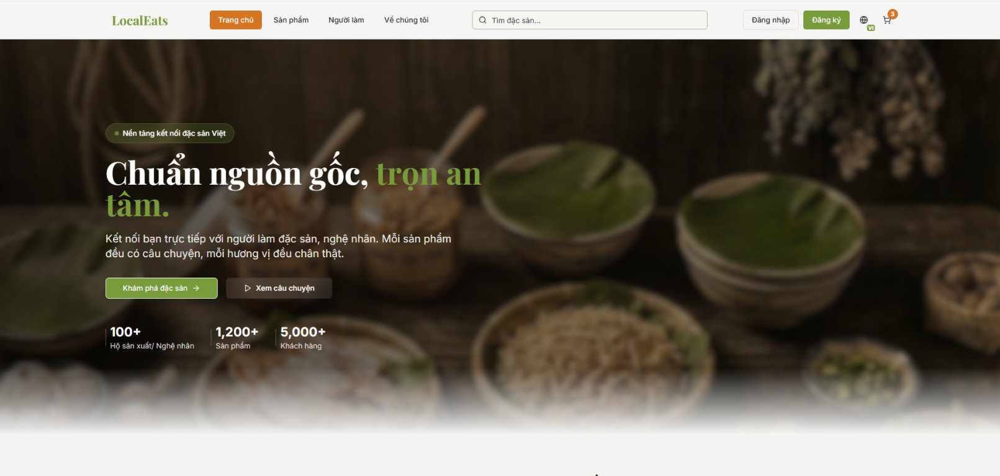

# LocalEats

LocalEats là nền tảng kết nối đặc sản Việt Nam với người tiêu dùng. Giao diện được thiết kế theo hướng hiện đại, gần gũi và truyền tải rõ câu chuyện nguồn gốc của từng sản phẩm, người làm và vùng miền.

## Giới thiệu giao diện



Trang chủ LocalEats sử dụng tông màu nâu ấm và xanh lá, gợi liên tưởng đến nông sản, làng nghề và những giá trị bản địa. Các khu vực chính gồm:

- **Thanh điều hướng:** hiển thị logo LocalEats, liên kết đến Trang chủ, Sản phẩm, Người làm và Về chúng tôi.
- **Tìm kiếm nhanh:** hỗ trợ tìm đặc sản theo tên ngay trên thanh điều hướng.
- **Khu vực tài khoản:** cho phép người dùng đăng nhập, đăng ký, chuyển ngôn ngữ và xem giỏ hàng.
- **Banner giới thiệu:** truyền tải thông điệp “Chuẩn nguồn gốc, trọn an tâm”, kèm nút khám phá đặc sản và xem câu chuyện thương hiệu.
- **Thông tin nổi bật:** giới thiệu số lượng hộ sản xuất/nghệ nhân, sản phẩm và khách hàng để tạo sự tin cậy.
- **Danh mục sản phẩm:** trình bày các đặc sản địa phương với hình ảnh trực quan, thông tin rõ ràng và trải nghiệm mua sắm dễ sử dụng.
- **Câu chuyện người làm:** giúp người dùng biết sản phẩm được tạo ra bởi ai, từ đâu và bằng phương pháp nào.

## Chạy dự án

```bash
npm install
npm run dev
```
